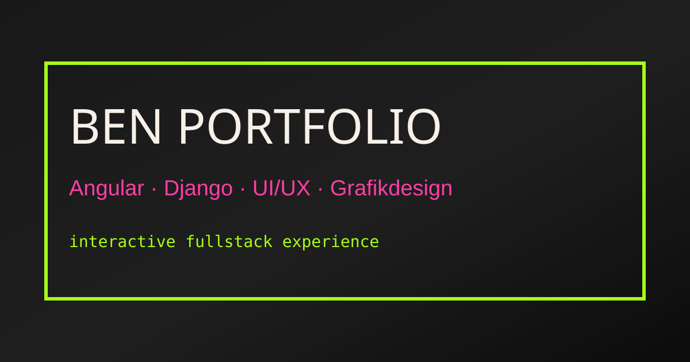

<p align="center">
  
</p>

<h1 align="center">B2FOLIO.DE</h1>

<p align="center">
  <strong>Design. Code. Repeat.</strong><br />
  An interactive Angular experience combining full-stack web development, UI/UX, graphic design, and controlled chaos.
</p>
<p align="center">
  <a href="https://b2folio.de/"></a>
  
  
  
</p>

> [!IMPORTANT]
> This repository is publicly viewable, but it is **not an open-source project**. Permission is granted solely to inspect and evaluate this work. Copying, cloning, modifying, executing, publishing, redistributing, or reusing any part of it without prior written permission is prohibited. The [B2FOLIO.DE Read-Only Source License](./LICENSE) applies.

---

```txt
┌─ b2folio.system ────────────────────────────────────────────┐
│ project     B2FOLIO.DE                                     │
│ stack       Angular · TypeScript · SCSS                    │
│ craft       Full Stack · UI/UX · Graphic Design            │
│ focus       Performance · Accessibility · SEO · Motion     │
│ state       clean structure / controlled chaos             │
└─────────────────────────────────────────────────────────────┘
```

## Contents

- [About the Project](#about-the-project)
- [Highlights](#highlights)
- [Project Areas](#project-areas)
- [Selected Case Studies](#selected-case-studies)
- [Standalone Design Studies](#standalone-design-studies)
- [Architecture](#architecture)
- [Tech Stack](#tech-stack)
- [Project Structure](#project-structure)
- [Quality and Accessibility](#quality-and-accessibility)
- [Implementation and Delivery](#implementation-and-delivery)
- [License and Usage](#license-and-usage)
- [Author](#author)

## About the Project

**B2FOLIO.DE** is not a conventional one-page portfolio. It is an animated, bilingual web experience that combines a professional portfolio structure with a distinctive visual system built around MS-DOS dialogs, terminal elements, halftone assets, glitch layers, poster-style UI, scroll snapping, and interactive project scenes.

The goal is a website that remains technically controlled while making a strong visual impression: component-based, responsive, SEO-friendly, accessibility-conscious, and built without an off-the-shelf UI component library.

**Live version:** [https://b2folio.de/](https://b2folio.de/)

## Highlights

| Area | Implementation |
| --- | --- |
| **Hero Experience** | Full-screen hero with poster-style UI, halftone portrait, glitch layers, and a system dialog |
| **Startup Loader** | Custom B² boot sequence with a reduced alternative for corresponding motion preferences |
| **Themes** | Persistent dark and light modes powered by centralized theme tokens and services |
| **Accessibility** | Adjustable contrast, color-vision, typography, comfort, and motion preferences |
| **Languages** | Complete German and English content with a persistent language switcher |
| **Navigation** | Sticky navigation, custom cursor, scroll-to-top control, and body-based scroll snapping |
| **Repository Gate** | Footer button without an `href`, a security question, and a rotating stack of five error dialogs |
| **Motion** | Viewport-driven reveals, staggered animations, and performant deferred sections |
| **Case Studies** | Dedicated detail pages covering architecture, role, stack, highlights, and visual project scenes |
| **SEO** | Route-specific metadata, canonical URLs, structured data, sitemap, and social meta tags |
| **Contact** | Angular form with a CSRF-protected connection to the centralized Infrastructure API |

## Project Areas

| Route / Area | Description |
| --- | --- |
| **`/`** | Homepage with hero, about section, experience, skills, process, projects, FAQ, and contact form |
| **`/portfolio`** | Overview of the selected case studies |
| **`/projects/:slug`** | Dynamic project detail pages with individual visual direction |
| **`/design-studies/:study/`** | Eight independent interactive studies, served as static pages alongside Angular |
| **`/snippets`** | Short technical examples with isolated demo assets |
| **`/achievements`** | Unlockable interactions and portfolio achievements |
| **`/danke`** | Confirmation page after a successful contact request |
| **`/impressum`** | Legal notice and provider information |
| **`/datenschutz`** | Privacy policy |
| **Fallback** | Custom 404 page for unknown routes |

## Selected Case Studies

| Project | Focus |
| --- | --- |
| **Intranet** | Modular Angular and Django platform with apps, roles, permissions, communication, and automation |
| **Dein Fußabdruck** | Interactive web and game project featuring simulation, animation, and gameplay logic |
| **Carly Managed** | Project management application with boards, tasks, live synchronization, and gamification |
| **Globi Flow** | Published local lab-report assistance system with OCR, review workflows, hardened upload isolation, controlled knowledge content, and patient reports · [Live Demo](https://globi-flow-demo.b2folio.de/) · [Frontend](https://github.com/benjaminBennewitz/Globi-Flow.git) |
| **Graphic Design Catalog** | Editorial design catalog with a reader, gallery, and creative project presentation |

> **Globi Flow backend:** The Django backend is maintained in a separate private repository and is intentionally not published or linked from the portfolio. This reduces unnecessary disclosure of server-side implementation and deployment details. Repository privacy is an additional defense-in-depth measure and does not replace runtime hardening, secret isolation, access controls, or server segmentation.

## Standalone Design Studies

> [!NOTE]
> The standalone design studies are non-commercial experiments in graphic design and web development. Some begin with a visual language or illustrated identity; others begin with a theme or a technical interaction. Their READMEs explain that intent before the implementation details. They are not production products or commercial services. Accessibility and production readiness are not their primary evaluation goals; support varies, and no comprehensive accessibility audit or WCAG conformance is claimed for these studies.

Eight independent experiences explore distinct visual directions and interaction models. Cards and quicklinks live on `/portfolio#design-studies`. Each study has its own detailed README covering concept, interaction, learning objectives, architecture, and source notes.

### RAW/FORM

**Graphic-design-led.** RAW/FORM translates brutalist and neo-brutalist graphic principles into a responsive festival website: exposed grids, uncompromising typographic scale, hard divisions, and a restricted palette. Responsive behavior and motion are supporting challenges; the visual concept is the starting point.

[Study README](src/design-studies/brutalism/README.md) · [Open study](https://b2folio.de/design-studies/brutalism/)

### [WHATWESEE]

**Graphic-design-led.** [WHATWESEE] translates Swiss / International Typographic Style into a responsive photographic journal. Grid, typographic hierarchy, asymmetrical balance, and empty space organize Benjamin Bennewitz's own photographs; implementation and restrained motion support the editorial concept.

[Study README](src/design-studies/swiss/README.md) · [Open study](https://b2folio.de/design-studies/swiss/)

### CTRL//ROOM

**Graphic-design-led.** CTRL//ROOM translates Y2K visual culture into an electronic-music website: chrome typography, translucent cobalt surfaces, orbital imagery, icy silver, and magenta form a coherent graphic system. A custom media-player shell anchors the composition, with the same material language carried into the artist profile, archive, navigation, and dialogs. Web Audio and archive interactions support the design brief.

[Study README](src/design-studies/ctrl-room/README.md) · [Open study](https://b2folio.de/design-studies/ctrl-room/)

### TYPE破BREAK

An interactive manifesto about pressure, destruction, and creative transformation. Scroll-driven typography leads into a Canvas fragment simulation, a local poster editor with PNG export, and a printable manifesto.

[Study README](src/design-studies/type-break/README.md) · [Open study](https://b2folio.de/design-studies/type-break/)

### SCOOP!

**Illustration- and animation-led.** Doodles, expressive ice cream characters, faces, gestures, speech bubbles, and comic timing define SCOOP!. The fictional shop supplies a setting for that visual world; product selection and cart behavior support the character and animation experiments.

[Study README](src/design-studies/scoop/README.md) · [Open study](https://b2folio.de/design-studies/scoop/)

### FOLD.

**Technical interaction study.** FOLD. explores how six HTML panels can behave as one connected spatial object and unfold into a net. Camera orientation, hinge hierarchies, scroll mapping, and mobile gestures are the main challenge; the graphic composition gives the interaction a narrative.

[Study README](src/design-studies/fold/README.md) · [Open study](https://b2folio.de/design-studies/fold/)

### GROWTH.

**Theme-led 3D study.** A tree and its habitats determine the subject and upward journey of GROWTH. The central challenge is interpreting that theme through procedural modeling, camera composition, rendering, and HTML annotations, rather than translating an established graphic-design style.

[Study README](src/design-studies/growth/README.md) · [Open study](https://b2folio.de/design-studies/growth/)

### BENTENDO™ / DUNGEON WANTED

**OOP and 3D study.** BENTENDO combines a simulated handheld with a playable Canvas RPG to explore object-oriented composition, state ownership, and cooperation between device, input, display, audio, and game systems. The nostalgic visual setting gives the technical experiment a concrete purpose.

[Study README](src/design-studies/bentendo/README.md) · [Open study](https://b2folio.de/design-studies/bentendo/)

### Shared integration

Each study owns its HTML, styles, scripts, and assets. Angular copies these experiences as static pages; portfolio theme, language, and accessibility services do not automatically apply to them. Dependencies and supported interactions are documented in each study's README. Framework-free interaction code is written in VanillaJS; individual studies also explore Canvas, SVG, WebGL, Web Audio, or CSS3D.

## Architecture

| Layer | Responsibility |
| --- | --- |
| **Core** | Centralized content, data models, and services for SEO, language, themes, APIs, and application state |
| **Layout** | Global application shell containing navigation, loader, footer, overlays, toasts, and accessibility controls |
| **Pages** | Lazy-loaded route components and page-specific orchestration |
| **Shared** | Reusable experience, visual, dialog, project, and motion components |
| **Styles** | Global tokens, base rules, utilities, and project-specific case-study styles |
| **Environments** | Public environment-specific frontend configuration only |

## Tech Stack

| Layer | Technologies |
| --- | --- |
| **Framework** | Angular 21.2 with standalone components and signals |
| **Language** | TypeScript 5.9 in strict mode |
| **Reactivity** | Angular Signals and RxJS 7.8 |
| **Styling** | SCSS, CSS custom properties, and semantic design tokens |
| **UI Approach** | Custom components without Angular Material |
| **Routing** | Angular Router with lazy-loaded pages and dynamic project detail routes |
| **Testing** | Vitest 4 with jsdom through the Angular unit-test builder |
| **SEO** | Angular Meta service, canonical URLs, structured data, Open Graph, and Twitter Cards |
| **Assets** | Local variable fonts, a reduced Material Symbols font, and WebP and SVG graphics |

## Project Structure

```txt
src/
├─ app/
│  ├─ core/
│  │  ├─ data/                 # Portfolio content, translations, and project data
│  │  ├─ models/               # Content and project models
│  │  └─ services/             # API, SEO, language, theme, and application state
│  ├─ layout/                  # Global application shell and system-wide UI
│  ├─ pages/                   # Routed pages
│  └─ shared/                  # Reusable UI and experience components
├─ assets/
│  ├─ fonts/                   # Local fonts and reduced icon font
│  ├─ images/                  # Hero, loader, and project assets
│  ├─ snippet-demos/           # Isolated examples for the snippets page
│  └─ social/                  # Social and repository preview
├─ design-studies/            # Independent experiences; each folder has its own README
│  ├─ brutalism/              # RAW/FORM
│  ├─ swiss/                  # [WHATWESEE]
│  ├─ ctrl-room/              # CTRL//ROOM
│  ├─ type-break/             # TYPE破BREAK
│  ├─ scoop/                  # SCOOP!
│  ├─ fold/                   # FOLD.
│  ├─ growth/                 # GROWTH.
│  └─ bentendo/               # BENTENDO / DUNGEON WANTED
├─ environments/              # Public frontend configuration by environment
├─ styles/                    # Tokens, base styles, utilities, and case-study styles
├─ styles.scss                # Global SCSS entry point
├─ robots.txt                 # Crawler configuration
└─ sitemap.xml                # Public sitemap
```

## Quality and Accessibility

The following features describe the main Angular portfolio. Standalone studies have their own experimental scope and do not automatically inherit these features.

- strict TypeScript and Angular template checks
- semantic HTML structure and a consistent heading hierarchy
- visible focus states and keyboard interaction support
- ARIA labels for interactive elements and controls requiring additional context
- contrast-conscious dark and light themes with additional accessibility preferences
- support for reduced or disabled motion
- responsive layouts ranging from small smartphones to ultrawide viewports
- lazy-loaded routes and `@defer` blocks for resource-intensive sections
- unit tests covering central content integrity and Contact API behavior
- production budgets for the initial bundle and component styles

Material Symbols are bundled as a reduced local font, so icon rendering does not depend on an external font CDN.

## Implementation and Delivery

The portfolio is an Angular application with lazy-loaded pages, centralized services, shared components, and a token-based SCSS system. Production configuration includes optimization, hashed application bundles, public environment configuration, and size budgets.

The `angular.json` asset rules publish all eight standalone studies alongside the application. Selected source-only material is excluded, including SCOOP artwork masters and BENTENDO tests, generators, Blender sources, and internal documentation. Static delivery also includes `.htaccess`, crawler configuration, the sitemap, fonts, and study assets.

Local deployment utilities are kept outside Git tracking in the root-level `scripts/` directory. Nested study runtime scripts remain versioned. These implementation notes document the work for review; they are not installation instructions or permission to reproduce, execute, deploy, or reuse it.

## License and Usage

This project is **proprietary and not open source**. Its public visibility serves exclusively to allow professional and design-related evaluation.

Without prior explicit written permission, you may not:

- copy, clone, or permanently store the source code or assets,
- run, build, modify, publish, or host the project,
- adopt code, layouts, copy, graphics, animations, branding, or case studies,
- use the project, in whole or in part, in private, public, or commercial work,
- use its content for AI or machine-learning training, datasets, or automated reproduction,
- reuse personal data, contact details, or information from the legal notice.

Neither the public visibility of this repository nor any technically available GitHub feature grants additional usage rights. The complete [B2FOLIO.DE Read-Only Source License](./LICENSE) applies to original project contributions. Clearly marked third-party components remain subject to their respective license terms. This includes fonts, models, textures, sprites, music, and sound effects in standalone studies. Attribution does not grant permission to republish asset source files. Study-specific READMEs and credit records describe source material and applicable third-party notices. The repository license does not override third-party conditions.

### Photography and generated media

All photographs in the SWISS / [WHATWESEE] study are by Benjamin Bennewitz and carry visible author credits. They remain subject to the portfolio license; public display does not grant permission to reuse them.

AI-generated photographic-looking material is identified separately in the relevant studies: RAW/FORM uses visible AI image badges, CTRL//ROOM labels its generated photographic motifs and track, and SCOOP! labels its fictional portrait placeholders. BENTENDO documents AI-assisted project music and third-party game assets in its credits. Procedural Three.js scenes, CSS3D composition, and Canvas rendering are not the same as AI image generation.

Origin labels do not imply that every generated output has the same copyright status, and they do not replace asset-specific terms. Original photography, authored design and code, AI-generated material, and third-party assets should be evaluated separately.

## Author

**Benjamin Bennewitz**
Full-Stack Web Development · UI/UX · Graphic Design

[b2folio.de](https://b2folio.de/) · [GitHub](https://github.com/benjaminBennewitz) · [LinkedIn](https://www.linkedin.com/in/benjamin-bennewitz-116a12306/)

```txt
clean structure / loud visuals / controlled chaos
```
